# Crypto: Symmetric vs Asymmetric in .NET

A learning repo that compares **symmetric** and **asymmetric** cryptography in .NET 10, with a runnable benchmark.

- **Part A, Encryption:** AES-256-GCM vs RSA-2048 OAEP-SHA256 vs hybrid (RSA wraps the AES key).
- **Part B, Authentication:** HMAC-SHA256 (symmetric) vs RSA-2048 PSS-SHA256 and ECDSA P-256 signatures (asymmetric).

Every number in this README was computed with .NET 10 (`System.Security.Cryptography`) or measured by the benchmark in [src/CryptoBenchmark](src/CryptoBenchmark). Nothing is invented.

## Contents

1. [Goals of cryptography](#1-goals-of-cryptography)
2. [What is encryption](#2-what-is-encryption)
3. [Symmetric encryption](#3-symmetric-encryption)
4. [Asymmetric encryption](#4-asymmetric-encryption)
5. [Hybrid encryption](#5-hybrid-encryption)
6. [Digital signatures](#6-digital-signatures)
7. [HMAC vs digital signature](#7-hmac-vs-digital-signature)
8. [Encrypt vs sign](#8-encrypt-vs-sign)
9. [Algorithms table](#9-algorithms-table)
10. [Symmetric vs Asymmetric (comparison)](#10-symmetric-vs-asymmetric-comparison)
11. [The benchmark](#11-the-benchmark)
12. [Project layout](#12-project-layout)

---

## 1. Goals of cryptography

**Definition:** cryptography protects data against people who should not read it, change it, or fake it.

| Goal | One-line definition | Question it answers |
|---|---|---|
| **Confidentiality** | Only the intended reader can read the data. | "Can anyone else read it?" |
| **Integrity** | Any change to the data is detected. | "Was it changed on the way?" |
| **Authentication** | You know who created the data. | "Who sent it?" |
| **Non-repudiation** | The sender cannot later deny sending it; a third party can check. | "Can the sender deny it in court?" |

**Example:** Alice sends Bob `"Pay 100 to Carol"`.

```
Initial data:
  message          : "Pay 100 to Carol"
  attacker         : Mallory, on the network

Commands:
  no encryption    : Mallory reads "Pay 100 to Carol"          -> confidentiality lost
  no integrity     : Mallory changes it to "Pay 900 to Carol"  -> Bob cannot tell
  no authentication: Mallory sends "Pay 100 to Mallory"        -> Bob thinks Alice sent it
  no non-repudiation: Alice later says "I never sent that"     -> Bob cannot prove she did

Result:
  every goal needs a different tool (table below)
```

**Goal → tool:**

| Tool | Confidentiality | Integrity | Authentication | Non-repudiation |
|---|:---:|:---:|:---:|:---:|
| Encryption only (AES-CBC, AES-CTR, RSA-OAEP) | ✅ | ❌ | ❌ | ❌ |
| Authenticated encryption (AES-GCM, ChaCha20-Poly1305) | ✅ | ✅ | ⚠️ only "someone with the key" | ❌ |
| Hash (SHA-256) | ❌ | ⚠️ only accidental changes (an attacker recomputes it) | ❌ | ❌ |
| HMAC (SHA-256 + shared key) | ❌ | ✅ | ⚠️ only "someone with the key" | ❌ |
| Digital signature (RSA-PSS, ECDSA, Ed25519) | ❌ | ✅ | ✅ | ✅ |

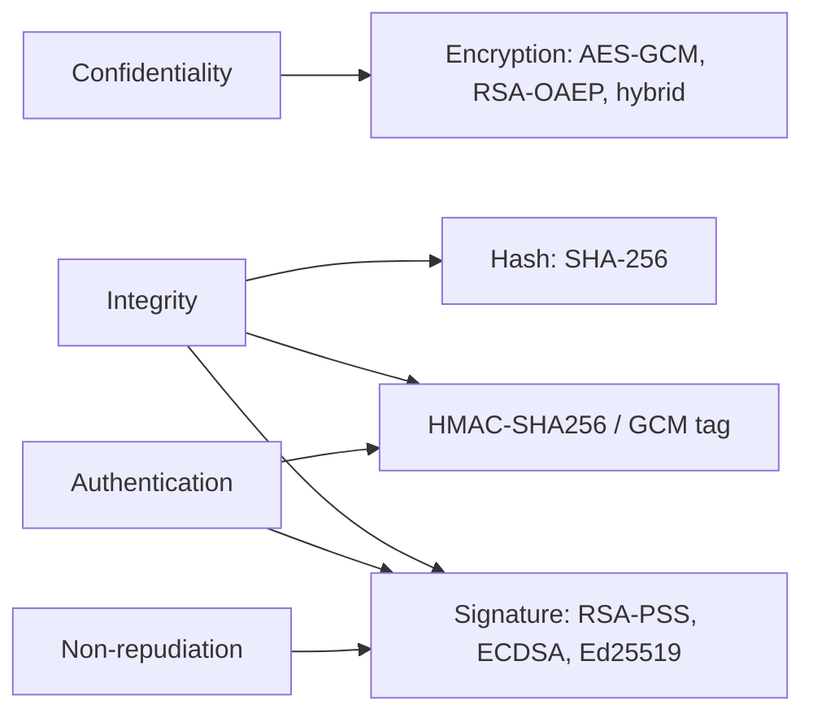

---

## 2. What is encryption

**Definition:** encryption turns readable data (plaintext) into unreadable data (ciphertext) with a key; only a holder of the right key can turn it back.

| Term | One-line definition | AES-256-GCM size |
|---|---|---|
| **Plaintext** | The original readable data. | any |
| **Key** | The secret that controls encryption/decryption. | 32 B |
| **Ciphertext** | The encrypted, unreadable data. | same as plaintext |
| **Nonce / IV** | A "number used once": makes the same plaintext encrypt differently each time. Not secret, but never reuse it with the same key. | 12 B |
| **Tag** | A checksum computed with the key: decryption fails if one bit of the ciphertext changed. | 16 B |

**Story: encrypt "Hello" with AES-256-GCM** (computed with .NET `AesGcm`):

```
Initial data:
  message           : 0x48656c6c6f (5 B, "Hello")
  key               : 0x000102…1e1f (32 B)
  nonce             : 0x000000000000000000000001 (12 B)

Commands:
  encrypt(message)  : ciphertext 0x5db3d3902b + tag 0x77fb327973440d73114fe57214a91611
  decrypt(...)      : 0x48656c6c6f ("Hello")
  flip 1 bit of ciphertext, decrypt : AuthenticationTagMismatchException

Result:
  stored bytes      : 12 (nonce) + 5 (ciphertext) + 16 (tag) = 33 B
  overhead          : 28 B per message, for any message size
```

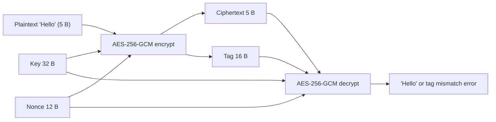

| | Usage | Why |
|---|---|---|
| ✅ | A fresh random 12 B nonce per message | GCM stays secure |
| ❌ | The same nonce twice with the same key | XOR of the two ciphertexts = XOR of the two plaintexts, and the tag key leaks |
| ✅ | AES-GCM (encrypts + authenticates) | Detects tampering |
| ❌ | AES-CBC/CTR without a MAC | An attacker can change bits without being detected |

---

## 3. Symmetric encryption

**Definition:** one shared secret key both encrypts and decrypts; sender and receiver must both have it.

**Example:**

```
Initial data:
  Alice and Bob     : share key K (32 B AES-256)

Commands:
  Alice             : C = AES-GCM-Encrypt(K, "Hello")
  Bob               : AES-GCM-Decrypt(K, C) = "Hello"

Result:
  1 key for 2 people
  benchmark         : 1000 × 190 B encrypted in 4.524 ms, decrypted in 2.291 ms
```

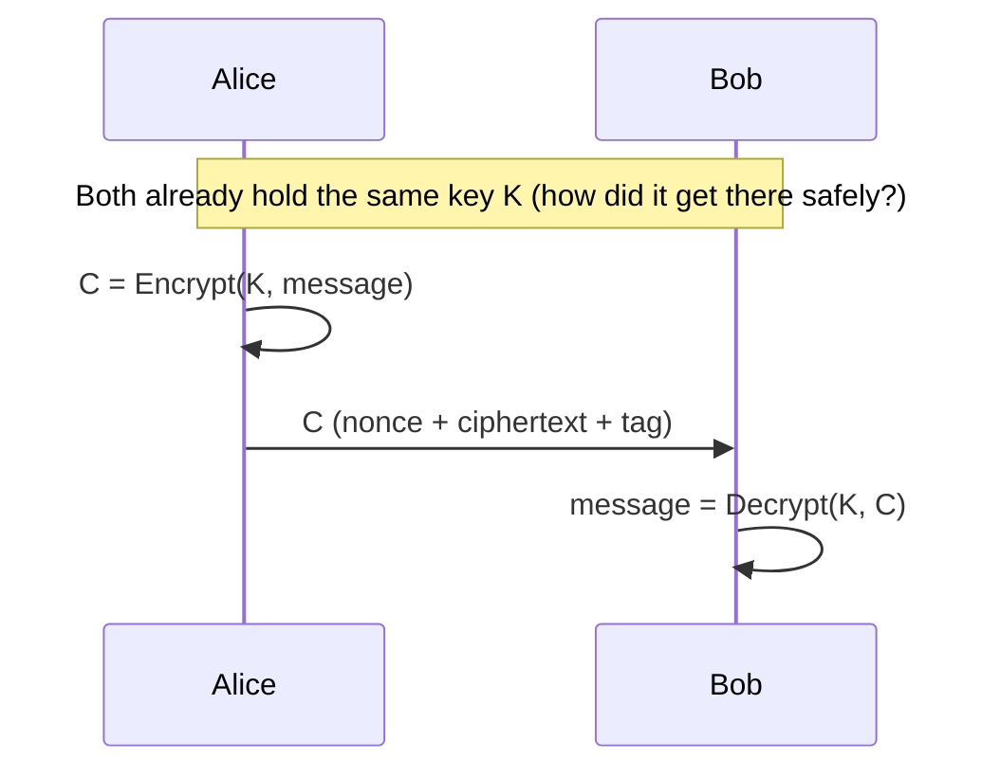

**The key-distribution problem:** every pair of people needs its own key, so `n` people need `n(n-1)/2` keys.

| People (n) | Symmetric keys n(n-1)/2 | Asymmetric key pairs (n) |
|---:|---:|---:|
| 2 | 1 | 2 |
| 10 | 45 | 10 |
| 100 | 4,950 | 100 |
| 1,000 | 499,500 | 1,000 |

| | Usage | Why |
|---|---|---|
| ✅ | AES for bulk data (files, DB rows, network traffic) | Fast: ~4.5 µs per 190 B message here |
| ❌ | Sending the AES key in the same channel as the data | Whoever reads the channel gets the key |

---

## 4. Asymmetric encryption

**Definition:** a key pair: the **public key** (shared with everyone) encrypts, the **private key** (kept secret) decrypts.

**Why it exists:** it solves the key-distribution problem. Bob publishes one public key; anyone can send him secrets without first sharing a secret.

**Example** (computed with .NET `RSA`, OAEP-SHA256):

```
Initial data:
  Bob's key pair    : RSA-2048 (public key 294 B SPKI, private key 1219 B PKCS#8)
  message           : "Hello" (5 B)

Commands:
  Alice             : C = RSA-Encrypt(Bob.public, "Hello")  -> 256 B
  Bob               : RSA-Decrypt(Bob.private, C)          -> "Hello"
  encrypt 190 B     : OK, 256 B
  encrypt 191 B     : error "data too large for key size"

Result:
  max plaintext     : 256 - 2×32 - 2 = 190 B (key size - 2×hash size - 2)
  ciphertext        : always 256 B (the key size), even for 5 B
  benchmark         : encrypt 47.2 µs, decrypt 1126.7 µs per message
```

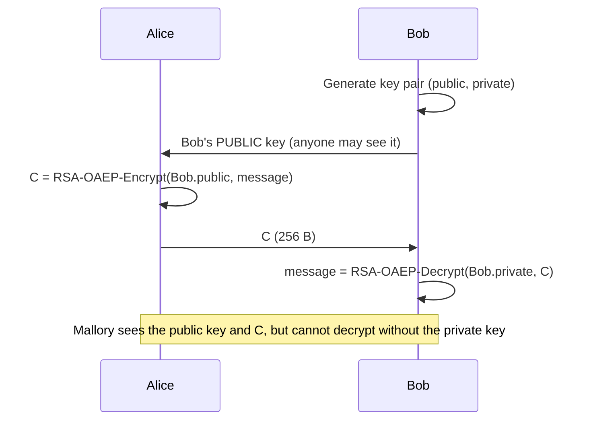

| | Usage | Why |
|---|---|---|
| ✅ | RSA to protect a small secret (an AES key) | Fits in 190 B |
| ❌ | RSA for a file or a long message | Max 190 B, and 172x slower than AES per round trip (section 11) |
| ✅ | OAEP padding | Proven secure |
| ❌ | PKCS#1 v1.5 encryption padding | Bleichenbacher padding-oracle attacks |

---

## 5. Hybrid encryption

**Definition:** asymmetric crypto (RSA or ECDH) protects a random AES key; AES encrypts the actual data. You get the key distribution of RSA with the speed of AES.

**Example** (the benchmark's `HybridCipher`, 1000 × 190 B):

```
Initial data:
  messages          : 1000 × 190 B
  Bob's key pair    : RSA-2048

Commands:
  generate AES key  : 32 B random
  wrap AES key      : RSA-OAEP-Encrypt(Bob.public, key) -> 256 B   (once per batch)
  encrypt messages  : AES-GCM × 1000                    -> 218 B each
  unwrap AES key    : RSA-OAEP-Decrypt(Bob.private, 256 B) -> 32 B (once per batch)
  decrypt messages  : AES-GCM × 1000

Result:
  output            : 256 + 1000 × 218 = 218,256 B (218.26 B per message, 14.87% overhead)
  time              : 4.242 + 3.488 = 7.730 ms vs pure AES 6.815 ms (1.13x)
  pure RSA          : 1173.892 ms (152x slower than hybrid)
```

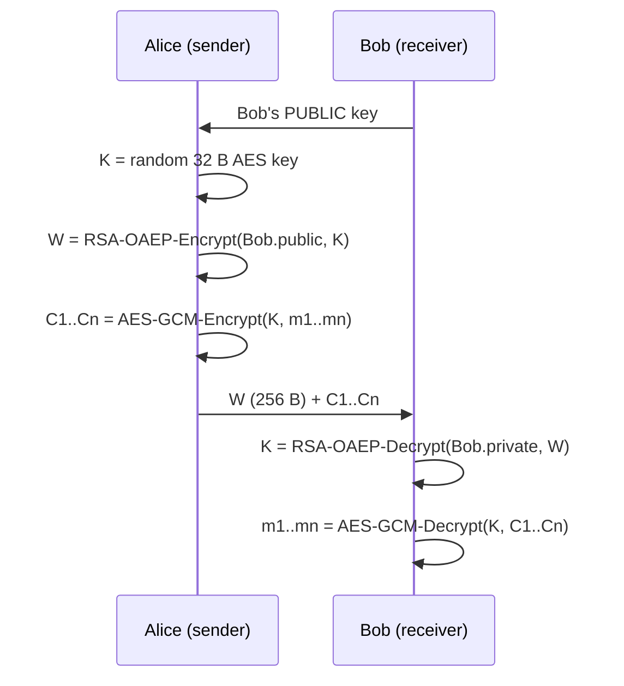

**TLS 1.3 (HTTPS) is hybrid:** an asymmetric key exchange (ECDHE, usually X25519) creates a shared secret; every byte of page data is encrypted with AES-GCM or ChaCha20-Poly1305; the server proves who it is with a signature.

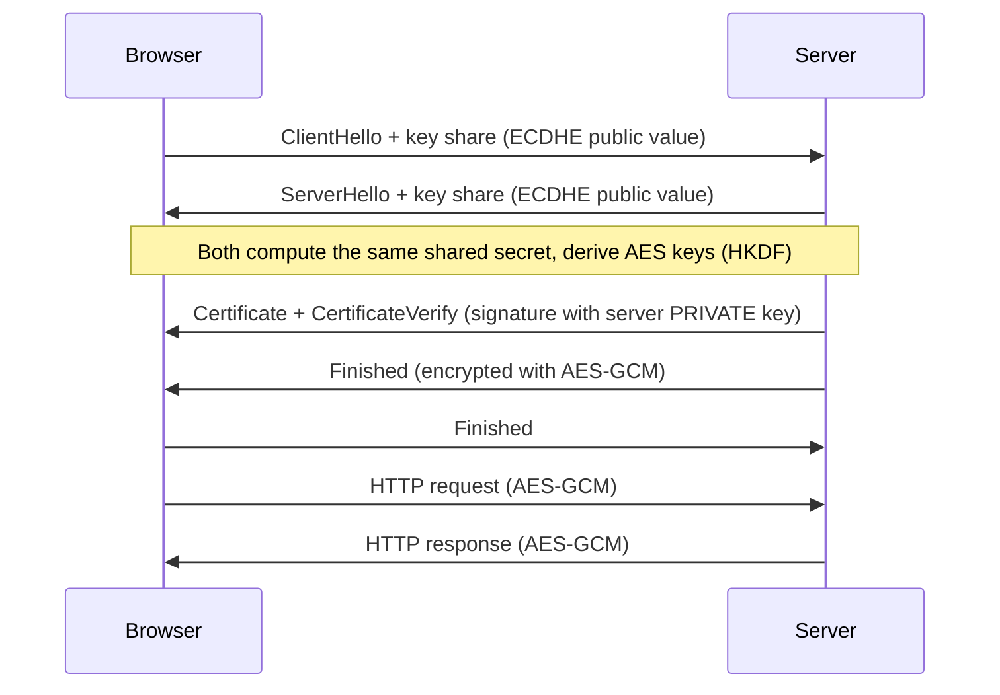

---

## 6. Digital signatures

**Definition:** hash the message, then sign the digest with the **PRIVATE** key; anyone verifies it with the **PUBLIC** key.

**Story: sign "Hello" with ECDSA P-256** (computed with .NET `ECDsa`, a fresh key, IEEE P1363 format):

```
Initial data:
  message           : "Hello" (0x48656c6c6f)
  key pair          : ECDSA P-256 (private 32 B scalar, public key SPKI 91 B)
  public key (SPKI) : 0x3059301306072a8648ce3d020106082a8648ce3d03010703420004b0b30f2d…ab175e9a

Commands:
  SHA-256("Hello")  : 0x185f8db32271fe25f561a6fc938b2e264306ec304eda518007d1764826381969
  sign(private)     : 0x2a3d3a58f81142d06f34d3ad14e848bf2c9426e550aa277d524e8b5b6734b10c
                        a11ecc9cd326c1d2493d0347c0bfa2dc2808037751148603d3b36ce5b9b100ea  (64 B = r | s)
  verify("Hello")   : true
  verify("Hellp")   : false   (SHA-256("Hellp") = 0x2113cd4a…1e8c4476, a different digest)

Result:
  signature size    : 64 B, for any message size
  ECDSA is randomized: signing "Hello" again gives a different signature, both valid
```

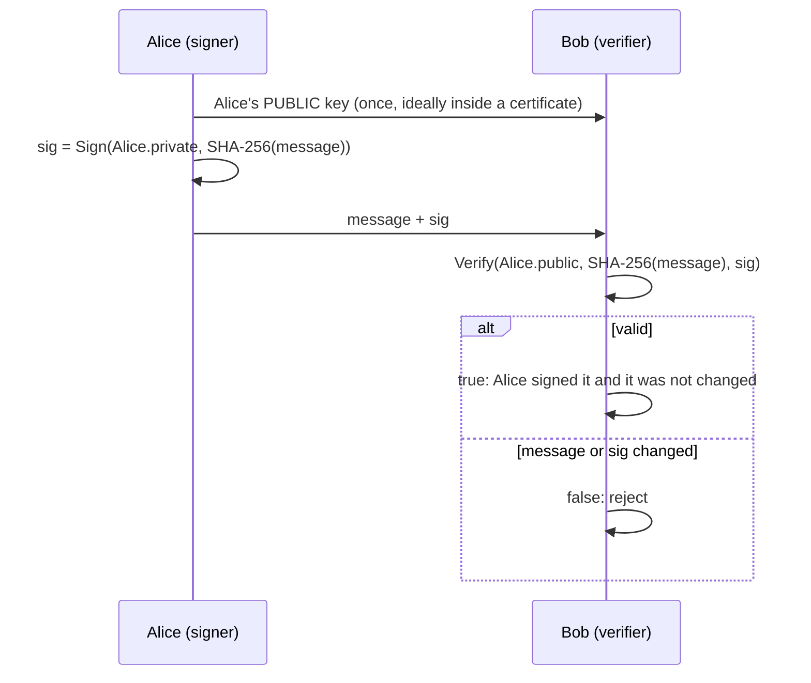

**Inside sign and verify:**

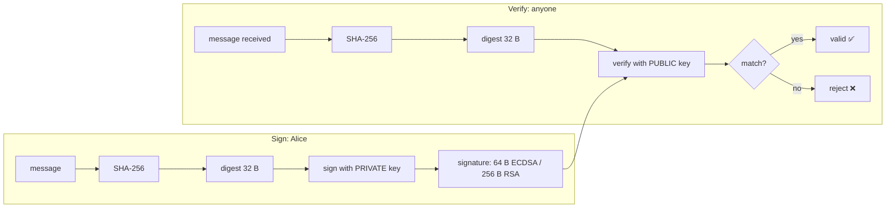

### Certificates and PKI

**Definition:** a **certificate** is a signed statement "this public key belongs to `example.com`"; a **Certificate Authority (CA)** signs it; **PKI** is the system of CAs, certificates and trust stores.

**Example:**

```
Initial data:
  your OS/browser   : trusts a fixed list of root CA public keys (the trust store)
  server            : sends its certificate + the intermediate certificate

Commands:
  check leaf        : Verify(Intermediate.public, leaf certificate)   -> true
  check intermediate: Verify(Root.public, intermediate certificate)   -> true
  check root        : is Root in my trust store?                      -> yes
  check name/dates  : leaf says "example.com", not expired            -> yes

Result:
  you now trust the server's public key, so you trust its signature in TLS
```

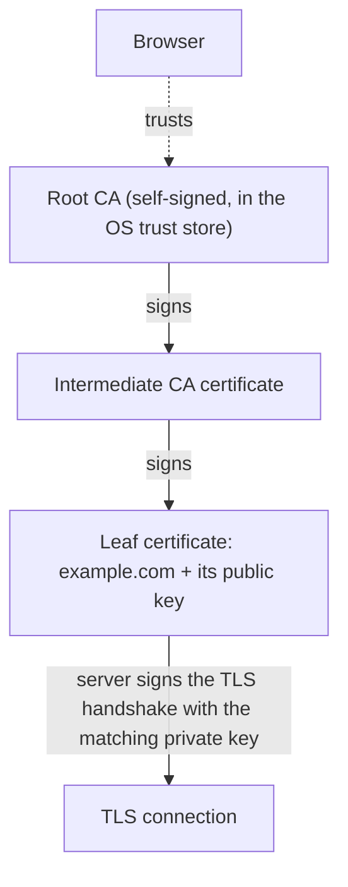

| | Usage | Why |
|---|---|---|
| ✅ | Sign with RSA-PSS, ECDSA or Ed25519 | Modern, proven schemes |
| ❌ | Trust a public key received over the same channel with no certificate | Mallory can swap in her own key (man-in-the-middle) |
| ✅ | Verify with the PUBLIC key only | The verifier never needs the secret |

---

## 7. HMAC vs digital signature

**Definition:** **HMAC** = a tag computed from the message and a **shared** secret key; a **signature** = a tag computed with a **private** key and checked with a public key.

**Example:**

```
Initial data:
  message           : "Hello"
  HMAC key          : 0x000102…1e1f (32 B, shared by Alice and Bob)

Commands:
  HMAC-SHA256(key, "Hello") : 0x0adc968519e7e86e9fde625df7037baeab85ea5001583b93b9f576258bf7b20c (32 B)
  Bob recomputes it, FixedTimeEquals : true
  ECDSA signature (section 6)        : 64 B, made with Alice's private key only

Result:
  HMAC: Alice OR Bob could have made the tag (both hold the key)
  ECDSA: only Alice could have made the signature
  benchmark (1000 × 190 B): HMAC 7.810 ms, ECDSA 118.339 ms, RSA-PSS 807.827 ms
```

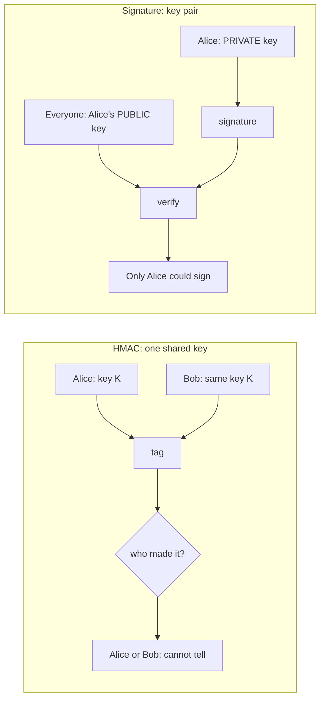

| Property | HMAC-SHA256 | Digital signature |
|---|:---:|:---:|
| Detects any change (integrity) | ✅ | ✅ |
| Proves "someone with the key" sent it | ✅ | ✅ |
| Proves WHO sent it to a third party (non-repudiation) | ❌ both sides hold the key | ✅ only the signer has the private key |
| Verifier needs no secret | ❌ verifier must hold the secret key | ✅ public key only |
| Speed (1000 × 190 B, sign + verify) | ✅ 7.810 ms | ❌ ECDSA 118.339 ms, RSA 807.827 ms |
| Output size | ✅ 32 B | ⚠️ ECDSA 64 B, RSA-2048 256 B |
| Works for many unknown verifiers | ❌ each needs the secret | ✅ publish the public key |

| | Usage | Why |
|---|---|---|
| ✅ | HMAC for API request signing between your own services, session cookies | Fast; both ends are yours |
| ❌ | HMAC to prove to a court that a customer sent an order | The server holds the key too and could forge it |
| ✅ | Compare tags with `CryptographicOperations.FixedTimeEquals` | Constant time |
| ❌ | Compare tags with `==` / `SequenceEqual` that exits early | Timing leaks how many bytes matched |

---

## 8. Encrypt vs sign

**Definition:** **encrypt** with the **receiver's PUBLIC** key (only the receiver can read); **sign** with the **sender's PRIVATE** key (everyone can check who sent it).

**Example:**

```
Initial data:
  Alice             : signing key pair (A.private, A.public)
  Bob               : encryption key pair (B.private, B.public)
  message           : "Hello"

Commands:
  1. sig = Sign(A.private, "Hello")              -> 64 B (ECDSA)
  2. C   = HybridEncrypt(B.public, "Hello" + sig) -> only Bob can read it
  3. Bob : "Hello" + sig = HybridDecrypt(B.private, C)
  4. Bob : Verify(A.public, "Hello", sig)        -> true

Result:
  confidentiality (only Bob reads) + authentication (Alice wrote it)
```

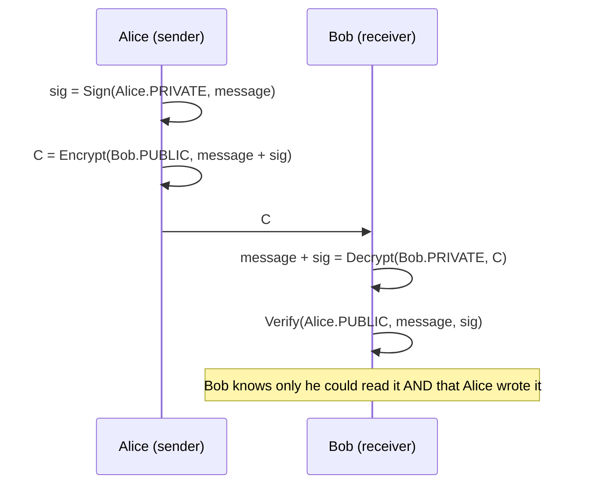

**Common mistakes:**

| Statement | ✅ / ❌ | Why |
|---|:---:|---|
| "Signing = encrypting with the private key" | ❌ | Only true for textbook RSA. RSA-PSS adds random salt, ECDSA and Ed25519 encrypt nothing. Signing and encryption are different operations with different paddings |
| "Encrypt with MY private key to keep it secret" | ❌ | Anyone with your public key can "decrypt" it: zero confidentiality |
| "Encrypt with the receiver's public key" | ✅ | Only the receiver's private key decrypts |
| "Sign with the sender's private key" | ✅ | Only the sender can produce it; anyone verifies |
| "Encryption proves who sent it" | ❌ | Anyone can encrypt to Bob's public key |
| "Use one RSA key pair for both encryption and signing" | ❌ | Separate keys: different lifetimes, and cross-protocol attacks. This repo uses two RSA keys |
| "Sign-then-encrypt hides the signature too" | ✅ | The signature also reveals who sent it, so encrypt it |
| "Encrypt-then-sign with a bare signature over the ciphertext" | ⚠️ | Mallory can strip the signature and sign the ciphertext as herself |

---

## 9. Algorithms table

**Definition:** the common algorithms, what they produce, and whether to use them today. Sizes for ML-KEM/ML-DSA/RSA/ECDSA/HMAC/AES-GCM were checked with .NET 10.

| Algorithm | Type | Key size | Output size | Security level | Status | Typical use | .NET API |
|---|---|---|---|---|:---:|---|---|
| AES-128-GCM | Symmetric AEAD | 16 B | message + 12 B nonce + 16 B tag | 128 bit | ✅ | TLS, disk, DB fields | `AesGcm` |
| AES-256-GCM | Symmetric AEAD | 32 B | message + 28 B | 256 bit (128 vs quantum) | ✅ | Same, long-term data | `AesGcm` |
| AES-CBC | Symmetric, no integrity | 16/32 B | message + 16 B IV + 1-16 B padding | 128/256 bit | ⚠️ needs HMAC | Legacy formats | `Aes.EncryptCbc` |
| AES-CTR | Symmetric stream, no integrity | 16/32 B | message + nonce | 128/256 bit | ⚠️ needs HMAC | Building block | none built in (build from `Aes.EncryptEcb`) |
| ChaCha20-Poly1305 | Symmetric AEAD | 32 B | message + 12 B nonce + 16 B tag | 256 bit | ✅ | TLS on phones without AES hardware, WireGuard | `ChaCha20Poly1305` |
| 3DES | Symmetric (64-bit block) | 24 B | message + 8 B IV + padding | 112 bit | ❌ disallowed by NIST | Old banking | `TripleDES` |
| RSA-OAEP | Asymmetric encryption | 2048-4096 bit | key size (256 B for 2048) | 112 bit (2048) | ✅ | Wrap an AES key | `RSA.Encrypt(..., OaepSHA256)` |
| RSA-PSS | Signature | 2048-4096 bit | key size (256 B) | 112 bit (2048) | ✅ | Certificates, code signing | `RSA.SignData(..., Pss)` |
| RSA PKCS#1 v1.5 | Encryption / signature | 2048-4096 bit | key size | 112 bit | ⚠️ encryption: padding oracle; signature: still common | Legacy TLS, JWT RS256 | `RSAEncryptionPadding.Pkcs1`, `RSASignaturePadding.Pkcs1` |
| ECDH P-256 | Key agreement | 32 B private | 32 B shared secret | 128 bit | ✅ | TLS key exchange | `ECDiffieHellman` |
| ECDSA P-256 | Signature | 32 B private | 64 B (P1363) | 128 bit | ✅ | TLS certs, JWT ES256, Apple/Android | `ECDsa` |
| Ed25519 | Signature | 32 B | 64 B | 128 bit | ✅ | SSH, Git, Signal | none built in |
| HMAC-SHA256 | MAC | 32 B (any) | 32 B | 256 bit | ✅ | API auth, JWT HS256, cookies | `HMACSHA256` |
| ML-KEM-768 | Post-quantum KEM | 1184 B public | 1088 B ciphertext, 32 B secret | NIST category 3 (≈ AES-192) | ✅ FIPS 203 | Hybrid TLS (X25519MLKEM768) | `MLKem` (.NET 10) |
| ML-DSA-65 | Post-quantum signature | 1952 B public | 3309 B | NIST category 3 | ✅ FIPS 204 | Future certificates, firmware | `MLDsa` (.NET 10) |

**Key-size equivalence** (same security level; [NIST SP 800-57 Part 1, Table 2](https://csrc.nist.gov/pubs/sp/800/57/pt1/r5/final)):

| Security level | Symmetric | RSA / DH | ECC (ECDSA/ECDH) |
|---:|---|---|---|
| 112 bit | 3DES | RSA-2048 | ECC-224 |
| **128 bit** | **AES-128** | **RSA-3072** | **ECC-256 (P-256, Ed25519)** |
| 192 bit | AES-192 | RSA-7680 | ECC-384 |
| 256 bit | AES-256 | RSA-15360 | ECC-512 (P-521) |

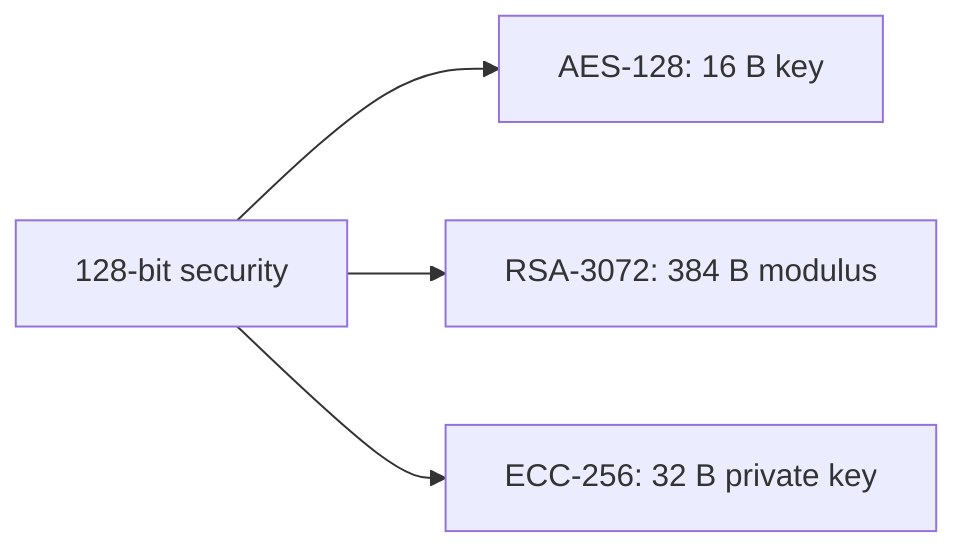

---

## 10. Symmetric vs Asymmetric (comparison)

### 10.1 Definitions

- **Symmetric:** one shared secret key does both directions: AES-GCM encrypts and decrypts, HMAC tags and verifies. Fast and small, but every pair of parties must first share the key secretly.
- **Asymmetric:** a key pair: the public key encrypts or verifies, the private key decrypts or signs. Solves key distribution and gives non-repudiation, but is 15x-170x slower and has small message limits (RSA).

### 10.2 Example per option (same scenario: 1000 messages × 190 B, averages from the benchmark run in section 11)

**Symmetric:**

```
Initial data:
  messages               : 1000 × 190 B = 190,000 B
  AES key                : 32 B (shared)
  HMAC key               : 32 B (shared)

Commands:
  AES-GCM encrypt all    : 4.524 ms
  AES-GCM decrypt all    : 2.291 ms
  HMAC sign all          : 3.371 ms
  HMAC verify all        : 4.439 ms

Result:
  ciphertext             : 1000 × 218 B = 218,000 B (+14.74%)
  tags                   : 1000 × 32 B = 32,000 B
  round trip / auth      : 6.815 ms / 7.810 ms
```

**Asymmetric:**

```
Initial data:
  messages               : 1000 × 190 B = 190,000 B
  RSA-2048 key pair      : public 294 B, private 1219 B
  ECDSA P-256 key pair   : public 91 B, private 138 B (PKCS#8)

Commands:
  RSA-OAEP encrypt all   : 47.212 ms
  RSA-OAEP decrypt all   : 1126.680 ms
  RSA-PSS sign all       : 777.681 ms
  RSA-PSS verify all     : 30.146 ms
  ECDSA sign all         : 32.747 ms
  ECDSA verify all       : 85.592 ms

Result:
  ciphertext             : 1000 × 256 B = 256,000 B (+34.74%)
  signatures             : RSA 256,000 B, ECDSA 64,000 B
  round trip / auth      : 1173.892 ms / RSA 807.827 ms, ECDSA 118.339 ms
```

### 10.3 Comparison table

| Criterion | Symmetric (AES-256-GCM, HMAC-SHA256) | Asymmetric (RSA-2048, ECDSA P-256) |
|---|---|---|
| Keys | 1 shared secret | Public + private pair |
| Key size | 32 B | RSA: 294 B public / 1219 B private; ECDSA: 91 B / 138 B |
| Keys for n parties | n(n-1)/2 (1000 → 499,500) | n pairs (1000 → 1000) |
| Max message | Any | RSA-2048 OAEP: 190 B; signatures: any (hash first) |
| Encryption round trip (1000 × 190 B) | 6.815 ms | 1173.892 ms (172.25x slower) |
| Authentication (1000 × 190 B) | HMAC 7.810 ms | ECDSA 118.339 ms (15.15x), RSA 807.827 ms |
| Output bytes per message | +28 B (GCM) / 32 B tag | 256 B ciphertext / 256 B RSA sig / 64 B ECDSA sig |
| Key generation (this run) | 0.1-8 ms (random bytes) | RSA 29.7-155.8 ms, ECDSA 8.0 ms |
| CPU | AES-NI hardware instructions | Big-number / elliptic-curve math |
| Non-repudiation | ❌ | ✅ |
| Quantum computers | AES-256 stays safe (Grover halves it to 128 bit) | RSA/ECC broken by Shor → move to ML-KEM / ML-DSA |
| **Cost** | **~7 µs CPU per message round trip; 28-32 B per message** | **~1174 µs (RSA) per round trip; 64-256 B per message** |

### 10.4 Positives

**Symmetric**
- 100x+ faster (6.815 ms vs 1173.892 ms per 1000).
- Small output: +28 B ciphertext, 32 B tag.
- Small keys (32 B), generated in microseconds.
- No message size limit.

**Asymmetric**
- No shared secret: publish the public key.
- Non-repudiation: only the private-key holder can sign.
- n key pairs instead of n(n-1)/2 keys.
- Verifiers need no secret (certificates, PKI).

### 10.5 Negatives

**Symmetric**
- The key must reach the other side secretly first.
- n(n-1)/2 keys for n parties.
- No non-repudiation: both sides can make the tag.
- Every verifier holds a key that can also forge.

**Asymmetric**
- Slow: RSA decrypt 1.13 ms, RSA sign 0.78 ms per message.
- RSA-2048 OAEP encrypts at most 190 B.
- Bigger output: 256 B RSA ciphertext/signature.
- RSA and ECC are broken by a future quantum computer.

### 10.6 Other solutions

**ECDH / X25519 key agreement**
- **Definition:** both sides combine their private key with the other's public key and get the same shared secret, then derive an AES key; nothing is "encrypted" with the public key.
- **Example:**
  ```
  Alice: a, A = a·G      Bob: b, B = b·G
  Alice: S = a·B         Bob: S = b·A      -> same 32 B secret
  AES key = HKDF(S)
  ```
- **Positives:** fast and small (32 B public key for X25519); forward secrecy with ephemeral keys; used by TLS 1.3, SSH, Signal.
- **Negatives:** needs both sides' keys (interactive or a published key); no authentication alone (pair it with a signature); broken by quantum.

**KEM (Key Encapsulation Mechanism), e.g. ML-KEM**
- **Definition:** `Encapsulate(public key)` returns a random shared secret plus a ciphertext; only the private key can `Decapsulate` the ciphertext back to the secret. The secret becomes the AES key.
- **Example:**
  ```
  Bob: ML-KEM-768 key pair (public 1184 B)
  Alice: (ct 1088 B, secret 32 B) = Encapsulate(Bob.public)
  Bob: secret 32 B = Decapsulate(Bob.private, ct)
  ```
- **Positives:** post-quantum (FIPS 203); simpler and safer API than RSA encryption (no padding choice); built into .NET 10 (`MLKem`).
- **Negatives:** larger keys/ciphertexts (1184 B / 1088 B); new, so today deployed as a hybrid with X25519.

**Envelope encryption with a KMS**
- **Definition:** a cloud Key Management Service holds a master key that never leaves it; each object is encrypted with its own data key (DEK), and the KMS encrypts (wraps) the DEK.
- **Example:**
  ```
  GenerateDataKey -> plaintext DEK 32 B + encrypted DEK
  AES-GCM(DEK, file); store file + encrypted DEK; forget plaintext DEK
  read: KMS.Decrypt(encrypted DEK) -> DEK -> AES-GCM decrypt
  ```
- **Positives:** master key never exposed; access control and audit log per decrypt; key rotation without re-encrypting data.
- **Negatives:** a network call per DEK unwrap (latency, cost per request); vendor dependency.

**Ed25519 signatures** (README only: .NET has no built-in Ed25519 API)
- **Definition:** a signature scheme on Curve25519: 32 B public key, 64 B deterministic signature, designed to be fast and hard to misuse.
- **Example:**
  ```
  ssh-keygen -t ed25519 -> 32 B public key
  sign("Hello") twice   -> the same 64 B signature (deterministic)
  ```
- **Positives:** small (32 B key, 64 B sig); no random nonce needed when signing (ECDSA nonce reuse leaks the key); default in OpenSSH, Git, Signal.
- **Negatives:** not built into .NET (needs a library); not quantum-safe; less support than ECDSA P-256 in older HSMs, smart cards and enterprise PKI.

### 10.7 Common systems

| System | Encryption | Authentication | Reference |
|---|---|---|---|
| TLS 1.3 (HTTPS) | ECDHE (X25519 / X25519MLKEM768) + AES-GCM / ChaCha20-Poly1305 | Certificate signature (ECDSA, RSA-PSS, Ed25519) + AEAD tags | [RFC 8446](https://datatracker.ietf.org/doc/html/rfc8446) |
| SSH | curve25519 key exchange + AES-GCM / ChaCha20-Poly1305 | Ed25519 / ECDSA / RSA host and user keys | [OpenSSH specs](https://www.openssh.com/specs.html) |
| PGP / OpenPGP | Hybrid: public key wraps a session key, AES encrypts | RSA / EdDSA signatures | [RFC 9580](https://www.rfc-editor.org/rfc/rfc9580) |
| Signal | X3DH/PQXDH key agreement (X25519 + ML-KEM) + Double Ratchet, AES-256 | XEdDSA signatures on prekeys, HMAC-SHA256 | [Signal docs](https://signal.org/docs/) |
| JWT HS256 | none | HMAC-SHA256 (symmetric: issuer and verifier share the key) | [RFC 7518 §3.2](https://datatracker.ietf.org/doc/html/rfc7518#section-3.2) |
| JWT RS256 / ES256 | none | RSA PKCS#1 v1.5 / ECDSA P-256 (anyone verifies with the public key) | [RFC 7518 §3.3-3.4](https://datatracker.ietf.org/doc/html/rfc7518#section-3.3) |
| Git commit signing | none | GPG, SSH (Ed25519) or X.509 signatures | [Git book: Signing your work](https://git-scm.com/book/en/v2/Git-Tools-Signing-Your-Work) |
| Code signing (Windows Authenticode) | none | RSA / ECDSA signature + certificate chain | [Microsoft Authenticode](https://learn.microsoft.com/en-us/windows-hardware/drivers/install/authenticode) |
| AWS KMS | Envelope encryption: KMS key wraps data keys, AES-256-GCM for data | KMS asymmetric signing keys, HMAC keys | [AWS KMS concepts](https://docs.aws.amazon.com/kms/latest/developerguide/kms-cryptography.html#enveloping) |

### 10.8 My opinion

- **Symmetric:** use it for all bulk data and for authentication between services you control. AES-GCM and HMAC are 15x-170x faster with tiny output. Its only real problem is getting the key there, which asymmetric crypto or a KMS solves.
- **Asymmetric:** use it only for small jobs: exchanging/wrapping keys and signing. Prefer ECDSA P-256 (or Ed25519) over RSA for new signatures: 64 B and 23.75x faster signing. Plan for ML-KEM/ML-DSA.
- **Recommended:** **hybrid**: asymmetric for the key (ECDH/ML-KEM or RSA-OAEP), AES-256-GCM for data, a signature when you need to prove who sent it. Here it costs only 1.13x pure AES.

---

## 11. The benchmark

### Terms

| Term | Definition | Default |
|---|---|---|
| **Message** | One random byte array that is encrypted or signed. | 190 B |
| **Batch** | All messages processed in one measured run of one method. | 1000 messages |
| **Loop** | One pass over every method with the whole batch. | 10 loops |
| **Op1 / Op2** | Encrypt / Decrypt in Part A; Sign / Verify in Part B. | |

### What it does

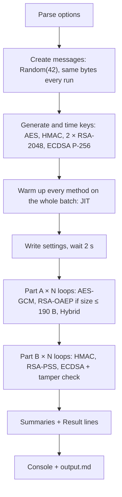

The **tamper check** flips one bit in message 0 and verifies it against its original signature; the verify must return `false` (✅ = tampering detected).

### Metrics

| Metric | How it is measured |
|---|---|
| Encrypt / Decrypt / Sign / Verify (ms) | `Stopwatch` around the whole batch |
| Allocated (B) | `GC.GetAllocatedBytesForCurrentThread()` difference: managed heap only, OpenSSL native memory not counted |
| Ciphertext / Signature (B) | Output bytes ÷ messages (hybrid adds its 256 B wrapped key once) |
| Overhead (%) | (ciphertext per message − message size) ÷ message size |
| Messages/s | messages ÷ (encrypt + decrypt time) |
| Signs/s, Verifies/s | messages ÷ sign time, messages ÷ verify time |
| GC pause (ms) | `GC.GetTotalPauseDuration()` difference; the summary shows the TOTAL over all loops |
| Round-trip / Valid / Tamper detected | every decrypted message equals the original / every signature verifies / the tampered message fails |

### Options

| Option | Default | Meaning |
|---|---|---|
| `--messages-count` | 1000 | Messages per batch |
| `--loop-counter` | 10 | Loops per part |
| `--message-size` | 190 | Bytes per message. Over 190, pure RSA encryption is skipped (signatures and hybrid still run) |

Any other option throws `ArgumentException: Unknown option: ...`.

### Run

```bash
cd src/CryptoBenchmark
dotnet run -c Release -- --messages-count 1000 --loop-counter 10
```

### Real output (summaries)

Machine: .NET 10.0.13, Ubuntu 26.04.1 LTS, workstation non-concurrent GC. Full per-loop output: [output.md](output.md).

| Setting | Value |
|---|---|
| Messages per batch | 1000 |
| Message size | 190 B |
| Loops | 10 |
| Total ops | 120000 (6 methods x 1000 messages x 10 loops x 2 ops) |
| Key generation: AES-256 (32 B random) | 8.209 ms |
| Key generation: HMAC-SHA256 (32 B random) | 0.099 ms |
| Key generation: RSA-2048 (encryption) | 155.846 ms |
| Key generation: RSA-2048 (signing) | 29.662 ms |
| Key generation: ECDSA P-256 | 7.951 ms |

**Part A summary (average of 10 loops, GC pause = total)**

| Method | Encrypt (ms) | Decrypt (ms) | Allocated (B) | Ciphertext (B) | Overhead (%) | Messages/s | GC pause total (ms) | Round-trip |
|---|---:|---:|---:|---:|---:|---:|---:|:---:|
| AES-256-GCM | 4.524 | 2.291 | 480,587 | 218 | 14.74 | 146,735 | 0.000 | ✅ |
| RSA-2048 OAEP-SHA256 | 47.212 | 1126.680 | 512,344 | 256 | 34.74 | 852 | 2.390 | ✅ |
| Hybrid RSA+AES-GCM | 4.242 | 3.488 | 481,024 | 218.26 | 14.87 | 129,379 | 2.348 | ✅ |

**Result:** AES is 172.25x faster than RSA; hybrid is 1.13x the cost of pure AES.

**Part B summary (average of 10 loops, GC pause = total)**

| Method | Sign (ms) | Verify (ms) | Allocated (B) | Signature (B) | Signs/s | Verifies/s | GC pause total (ms) | Valid | Tamper detected |
|---|---:|---:|---:|---:|---:|---:|---:|:---:|:---:|
| HMAC-SHA256 | 3.371 | 4.439 | 121,709 | 32 | 296,674 | 225,271 | 0.191 | ✅ | ✅ |
| RSA-2048 PSS-SHA256 | 777.681 | 30.146 | 401,472 | 256 | 1,286 | 33,172 | 0.000 | ✅ | ✅ |
| ECDSA P-256 | 32.747 | 85.592 | 1,713,472 | 64 | 30,537 | 11,683 | 3.601 | ✅ | ✅ |

**Result:** HMAC is 15.15x faster than ECDSA (sign + verify); ECDSA signs 23.75x faster than RSA; RSA verifies 2.84x faster than ECDSA.

Every loop showed ✅ for round-trip, valid and tamper detected. Sizes match the theory: AES 190 + 28 = 218 B, RSA ciphertext 256 B, HMAC tag 32 B, RSA signature 256 B, ECDSA signature 64 B.

**With `--message-size 4096`** (real run, 2 loops):

```
> Pure RSA encryption skipped: RSA-2048 OAEP-SHA256 encrypts at most 190 B (256 - 2*32 - 2), message is 4096 B. Hybrid and signatures still run.
| 2 | AES-256-GCM        | 7.600 | 5.792 | 8,288,520 | 4124    | 0.68 | 74,674 | 0.000 | ✅ |
| 2 | Hybrid RSA+AES-GCM | 7.283 | 6.244 | 8,288,912 | 4124.26 | 0.69 | 73,924 | 0.000 | ✅ |
| 2 | HMAC-SHA256         | 14.071  | 15.165 | 121,472   | 32  | 71,071 | 65,941 | 0.000 | ✅ | ✅ |
| 2 | RSA-2048 PSS-SHA256 | 731.126 | 39.587 | 401,472   | 256 | 1,368  | 25,261 | 0.000 | ✅ | ✅ |
| 2 | ECDSA P-256         | 44.153  | 99.328 | 1,713,472 | 64  | 22,648 | 10,068 | 0.000 | ✅ | ✅ |
```

The 28 B GCM overhead drops to 0.68% for 4096 B, and signature sizes do not change (the message is hashed first).

### How to read the result

Per message (summary ÷ 1000):

| Method | Op1 (µs) | Op2 (µs) | Which side is slow |
|---|---:|---:|---|
| AES-256-GCM | 4.5 encrypt | 2.3 decrypt | neither |
| RSA-2048 OAEP | 47.2 encrypt | 1126.7 decrypt | **private-key side** |
| HMAC-SHA256 | 3.4 sign | 4.4 verify | neither |
| RSA-2048 PSS | 777.7 sign | 30.1 verify | **private-key side** |
| ECDSA P-256 | 32.7 sign | 85.6 verify | **verify side** |

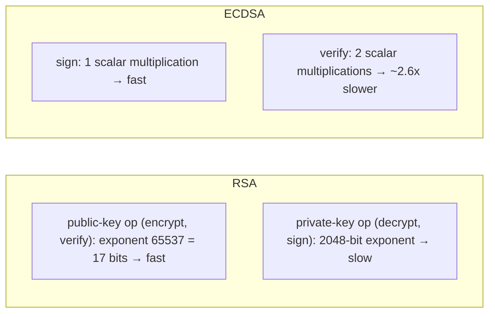

- **RSA: encrypting and verifying are fast, decrypting and signing are slow.** The public exponent is 65537 (17 bits); the private exponent is ~2048 bits.
- **ECDSA is the opposite:** signing (32.7 µs) is faster than verifying (85.6 µs).
- **Hybrid ≈ AES + one RSA operation:** hybrid decrypt 3.488 ms − AES decrypt 2.291 ms = 1.197 ms ≈ one RSA decrypt (1.127 ms).
- **Choose by workload:** many verifiers, one signer (software updates, certificates) → RSA verify is cheapest; a server signing many tokens → ECDSA signs faster and its signature is 4x smaller.
- **Noise:** single loops vary (e.g. RSA decrypt loop 1 = 2462.929 ms vs ~720-950 ms later) because of CPU frequency and other processes; read the averages, and run more loops for stable numbers.
- **Allocated** counts only managed memory: ECDSA's 1,713 B per message comes from the .NET wrapper; OpenSSL's own memory is not included.

---

## 12. Project layout

```
Crypto/
├── README.md                     this file
├── output.md                     copy of the real benchmark output
├── .gitignore                    from `dotnet new gitignore`
└── src/CryptoBenchmark/
    ├── CryptoBenchmark.csproj    net10.0, workstation non-concurrent GC, no NuGet packages
    ├── Program.cs                top-level flow: options → keys → warm-up → loops → summaries
    ├── Options.cs                --messages-count, --loop-counter, --message-size
    ├── MessageFactory.cs         Random(42) messages
    ├── ICipher.cs                Part A contract + EncryptedBatch
    ├── SymmetricCipher.cs        AES-256-GCM (nonce | ciphertext | tag)
    ├── AsymmetricCipher.cs       RSA-2048 OAEP-SHA256
    ├── HybridCipher.cs           RSA wraps a per-batch AES key, AES-GCM encrypts
    ├── IAuthenticator.cs         Part B contract
    ├── HmacAuthenticator.cs      HMAC-SHA256 + FixedTimeEquals
    ├── RsaSigner.cs              RSA-2048 PSS-SHA256
    ├── EcdsaSigner.cs            ECDSA P-256, IEEE P1363 (64 B)
    ├── Measurement.cs            Stopwatch, allocated bytes, GC pause
    └── Report.cs                 Markdown tables to console + output.md
```

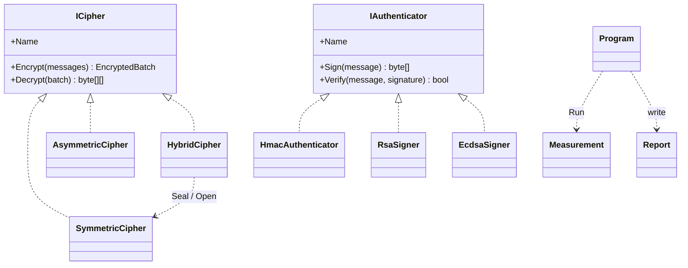
